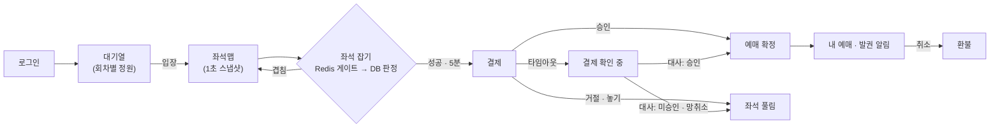
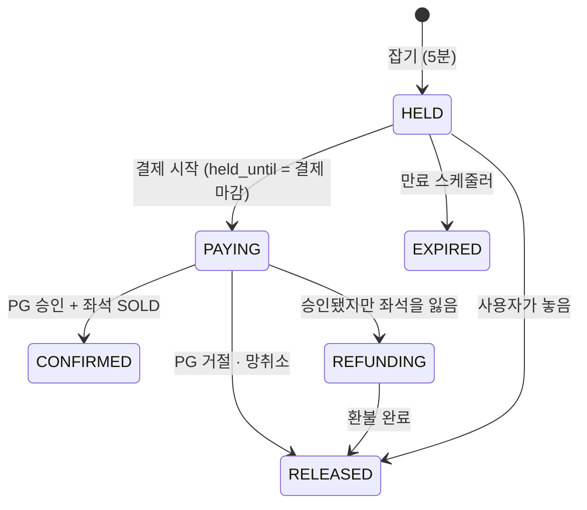

# 지정석 티켓 예매 시스템 (V7)

공연 좌석을 **좌석 단위로** 잡고, 결제하고, 확정·취소·환불까지 끝까지 처리하는 Spring Boot 예매 시스템입니다.
Redis는 이미 잡힌 좌석을 빠르게 거절하는 게이트로만 쓰고, 좌석 배정의 최종 판정은 MySQL 조건부 UPDATE가 합니다.
화면(로그인 → 대기열 → 좌석 선택 → 결제 → 내 예매)과 운영 현황 화면까지 들어 있어 예매 과정을 그대로 시연할 수 있습니다.

> 이전 버전(V1~V6: 재고 숫자 하나를 락으로 지키는 6가지 전략 비교)은 [`archive/v1-v6`](https://github.com/AnTaeho/ticketing-system/tree/archive/v1-v6) 브랜치에 있습니다. 아래 [이전 버전](#이전-버전-v1v6)에 요약과 V6 대비 변경점을 남겼습니다.

**기술 스택**: Java 17 · Spring Boot 4.0.6 · Hibernate 7.2 · MySQL 8.0+(로컬 9.3) · Redis 7.x(Lettuce, Lua) · Thymeleaf + 순수 JS · Gatling 3.9 · Gradle

---

## 왜 다시 만들었나

V6까지는 "재고 숫자 하나(`Concert.stock`, `stock:concert:{id}`)를 안전하게 줄이는" 같은 문제의 변주였습니다. 실제 공연 예매는 다릅니다.

1. **좌석마다 식별자와 가격이 다릅니다.** A구역 3열 9번은 다른 자리와 바꿀 수 없어서 카운터 하나로 표현할 수 없습니다.
2. **잡기 → 결제 → 확정의 단계가 있습니다.** "잡았지만 아직 안 산" 상태와 그 상태의 만료가 필요합니다.
3. **V6의 P99 125ms는 PENDING 접수 응답까지의 시간이었습니다.** 사용자에게 의미 있는 것은 좌석이 실제로 잡혔는지입니다.
4. **V6은 Redis가 진실의 원천이었습니다.** Redis 값이 과거로 돌아가면 오버셀이 나고, Kafka 전송 타임아웃을 실패로 보고 재고를 복구하면 이중 판매가 날 수 있었습니다.

V7은 V6의 핵심 생각("경합 판정은 짧은 원자 연산으로, 무거운 작업은 응답 경로 밖으로")을 유지하면서, **좌석 단위 판정 + DB 최종 판정 + 잡기·결제·확정 상태 머신**으로 바꿨습니다.

## 핵심 원칙

| 원칙 | 의미 |
|---|---|
| 진실은 DB | 좌석 배정은 MySQL 조건부 UPDATE의 영향 행 수로 판정합니다. Redis는 DB에서 다시 만들 수 있는 사본입니다 |
| Redis는 게이트 | 이미 잡힌 좌석 요청을 DB 앞에서 거절합니다. Redis가 틀리거나 사라지면 DB가 대신 거절하므로 중복 배정은 생기지 않습니다 |
| 락은 순간, 상태는 기간 | 판정 순간은 Lua와 조건부 UPDATE가 지키고, 결제 동안의 점유는 좌석 상태·`held_until`·TTL이 지킵니다. 분산 락은 쓰지 않습니다 |
| 외부 호출은 트랜잭션 밖 | PG 호출과 Redis 반영은 DB 트랜잭션이 커밋된 뒤에 합니다 |
| 타임아웃은 "모름" | PG 타임아웃을 실패로 보지 않습니다. 조회로 결론을 내고, 끝내 모르면 망취소 후 좌석을 풉니다 |
| 애매하면 언더셀 | 결과를 모를 때는 좌석을 묶어 두는 쪽으로 실패합니다 |

---

## 구조



| 구성 요소 | 하는 일 | 저장소 |
|---|---|---|
| 대기열 | 회차별 처리열 정원(기본 200)으로 좌석 화면 유입을 묶습니다. 정원 칸은 좌석 잡기가 DB 커밋까지 성공하거나, 좌석 화면의 생존 신호가 2분 끊기거나, 화면을 떠나고 10초가 지나면 비웁니다. 매진이면 새 진입과 승격을 멈추고 기다리던 사람에게 매진을 알립니다 | Redis Sorted Set + Lua |
| 좌석맵 | 리스를 잡은 서버 한 대가 1초마다 스냅샷을 만들고, 나머지는 로컬 캐시 → Redis 순으로 읽습니다 | Redis + 로컬 캐시 |
| 좌석 게이트 | `seat:{p:N}:<seatId> = holdToken`. 1인 동시 1건, 만료 좌석 재잡기 10분 쿨다운 | Redis Lua |
| 좌석 판정 | `UPDATE seat SET HELD ... WHERE id IN (...) AND (AVAILABLE OR held_until < NOW(6))`, 영향 행 수 = 좌석 수일 때만 성공 | MySQL |
| 결제 | 멱등키 · hold 행 락 + 조건부 전이 · 유니크 · PG 주문번호의 네 겹으로 이중 결제를 막습니다 | MySQL + Fake PG(HTTP) |
| 대사·워커 | 만료(SKIP LOCKED), 결제 대사, Outbox 워커(발권 알림·환불), 고아 게이트 키 정리 | MySQL + Redis 리스 |

키는 모두 해시 태그 `{p:<회차>}`를 붙여 한 회차의 키가 같은 슬롯에 모이게 했습니다(Redis Cluster 대비, 로컬은 단일 Redis).

### 좌석과 잡기 상태



- **결제 중(PAYING)은 만료 대상이 아닙니다.** 결제 시작 때 좌석의 `held_until`을 결제 마감(10분)으로 늘려, 잡기 5분이 지나도 결제 중인 좌석을 남이 가져가지 못하게 했습니다.
- **PG 타임아웃은 `UNKNOWN`입니다.** 대사 스케줄러가 PG에 조회해 승인이면 확정하고, PG에 주문이 없고 30초가 지났으면 망취소합니다. Fake PG는 망취소 기록(묘비)이 있는 주문의 늦은 승인을 거절합니다.
- **승인됐는데 좌석을 잃은 경우**는 같은 트랜잭션에 환불 작업(Outbox)을 기록하고 워커가 PG 취소를 합니다.

### 설계에서 고른 것

- **MySQL REPEATABLE READ 함정**: "유니크 위반 → 재조회"는 첫 SELECT 시점 스냅샷 때문에 방금 커밋된 행을 못 봅니다. 상태를 바꾸는 예매 트랜잭션은 `READ_COMMITTED`로 두고 부모 행을 `FOR UPDATE`로 잡아 직렬화했습니다.
- **SKIP LOCKED는 같은 트랜잭션에서**: 조회와 상태 변경을 한 트랜잭션에 묶어야 여러 서버가 같은 행을 집지 않습니다.
- **시간은 DB 시계**: 만료·마감 판정은 SQL의 `NOW(6)`로 하고, 자바에서 시각이 필요하면 DB 시각을 읽어 계산합니다.
- **Kafka를 쓰지 않음**: 확정 이후 작업(발권 알림, 환불)은 소비자가 하나라 같은 트랜잭션에 Outbox로 기록하고 폴링 워커가 처리하는 것으로 충분했습니다.
- **Redis 장애**: 대기열 진입은 막고(503), 이미 입장한 사람의 좌석 잡기는 DB 판정으로 계속 받되 서버당 동시 8건으로 묶습니다. 헬스는 `DEGRADED`(HTTP 200)로 내서 로드밸런서가 멀쩡한 서버를 빼지 않게 했습니다.

---

## 부하 테스트

Gatling으로 네 시나리오를 돌렸습니다. 좌석은 800석(4구역 × 10열 × 20석), 사용자는 로그인 → 대기열 → 좌석맵 → 2석 잡기 → 결제까지 진행합니다. Fake PG는 같은 앱 안에서 50~150ms 지연 후 승인합니다. 회차마다 새 공연 회차를 만들고, 부하가 끝난 뒤 DB와 Redis를 직접 조회해 정합성을 검사했습니다. 18회 모두 오버부킹 0, 정합성 검사 159건 위반 0이었습니다.

| 시나리오 | 조건 | 본 것 |
|---|---|---|
| S1 오픈 러시 | 2,000명 / 10초, 70%가 VIP 20석에 몰림, 정원 사실상 무제한 | 게이트 ON/OFF 비교, 3회씩 |
| S2 대기열 정원 | 5,000명 / 20초, 정원 200, 입장 대기 한도 120초 | 매진 시간·입장 대기·포기 수, 대기열 수정 전후 2회씩 |
| S3 결제 장애 | S1 조건 + PG 거절 10%, 응답 지연 10%(5초, 클라이언트 제한 3초) | 결과 모름 결제의 대사 정리, 2회 |
| S4 서버 두 대 | S1 조건, 앱 두 대가 같은 MySQL·Redis 사용 | 스케줄러 리스·SKIP LOCKED 아래 정합성, 2회 |

### S1 오픈 러시: 게이트 ON / OFF

회차 중앙값입니다.

| 항목 | 게이트 ON | 게이트 OFF |
|---|---|---|
| 좌석 잡기(첫 시도) P50 / P99 | 0 / 25 ms | 2 / 34 ms |
| 결제 P50 / P99 | 119 / 214 ms | 119 / 201 ms |
| 잡기 요청 / 성공 | 3,344 / 400 | 3,095 / 400 |
| **DB까지 간 잡기 요청** | **400** (성공 수와 같음) | **3,095** |
| MySQL `Com_update` 증가 | 3,212 | 5,907 |
| 행 락 대기 | 0건 | 10건 / 22 ms |
| 매진까지 | 7.2 s | 6.4 s |

**읽는 법**: 게이트를 켜면 DB에 닿는 잡기 요청이 성공한 건수만큼으로 줄었습니다(3,095 → 400). 거절은 ON에서 전부 Redis 게이트가, OFF에서 전부 DB 조건부 UPDATE가 냈습니다. 이 부하에서는 DB가 실패하는 UPDATE를 몇 ms 안에 끝내서 응답 시간 차이는 작았고, 차이는 DB 쓰기 양과 행 락 대기에서 드러났습니다.

### S2 대기열 정원: 칸을 붙잡던 문제를 고친 전후

| 회차 2회 | 수정 전 | 1차 수정 뒤 | 2차 수정 뒤 |
|---|---|---|---|
| 매진까지 | 73.4 s / 매진 못 함(216건 확정) | 18.3 / 14.7 s | 15.8 / 15.3 s |
| 매진 뒤 좌석 화면에 들어온 사람 | — | 2,003 / 2,020 | 15 / 5 |
| 매진 알림을 받고 끝난 사람 | — | — | 4,206 / 4,201 |
| 120초 기다리다 포기 | 4,400 / 4,584 | 2,211 / 2,202 | 0 / 0 |
| 처리열 최댓값(정원 200) | 재지 않음 | 200 / 200 | 200 / 200 |

- **수정 전**: 정원 칸은 잡기에 성공해야 비워졌습니다. 409를 받고 떠난 사용자의 칸이 토큰 수명 동안 막혀 매진이 늦어지거나 멈췄습니다.
- **1차 수정**: 좌석 화면이 생존 신호를 보내고, 신호가 2분 끊기거나 화면을 떠나면 칸을 비웁니다(새로고침은 10초 유예 안에 되돌립니다). 매진은 당겨졌지만, 매진 뒤에도 대기열이 계속 들여보냈습니다.
- **2차 수정**: 좌석맵 스냅샷을 만들 때 매진 표시를 함께 써서, 대기열이 DB를 치지 않고 매진을 압니다. 매진이면 진입은 409 `SOLD_OUT`, 순서 조회는 `SOLD_OUT`을 받고 화면이 「매진됐어요」를 띄웁니다. 대기 중에 화면을 떠난 사람은 10초 뒤 줄에서 뺍니다.
- 남은 한계: 매진 표시는 1초마다 쓰므로 마지막 확정과 표시 사이에 승격된 몇 명이 남습니다. 스냅샷을 끄면(`snapshot-enabled=false`) 매진을 알아채지 못합니다.
- 같은 수정 뒤 S1을 다시 재 보니 DB까지 간 잡기 400, `Com_update` 3,211로 그대로였습니다.

### S3 결제 장애, S4 서버 두 대

- **S3**: 결제 응답은 회차당 200이 353·364건, 결과 모름(202)이 47·36건, 거절(402)이 45·36건이었습니다. 부하가 끝난 뒤 대사 스케줄러가 결과 모름 결제를 PG에 다시 물어 12.3초·10.3초 만에 모두 승인이나 거절로 정리했고, 열린 결제·결제 중 선점·남은 Outbox 작업은 0이 됐습니다. 결제 P99는 3,049 ms로 클라이언트 제한(3초)에 걸린 요청이 그대로 드러났습니다.
- **S4**: 두 서버가 HTTP 요청 11,918 / 12,019건, Outbox 작업 406 / 394건으로 나눠 처리했고 두 회차 모두 7.3초에 매진, 확정 400건(800석)이었습니다. 한 기계에 JVM 두 개를 띄웠으므로 응답 시간을 서버 수의 효과로 읽지는 않습니다.

측정 환경: 10코어 · 16GB 노트북(Apple M4) 한 대에 앱·MySQL 9.3·Redis 7.2·Gatling을 함께 띄웠습니다. 회차마다 시작 직전 1분 평균 부하가 3 미만인 것을 확인했고, 실행 중 다른 프로세스가 CPU를 크게 쓴 회차는 없었습니다. 절대 수치보다 같은 조건에서의 비교로 읽어 주세요.

**측정하다 고친 것**: 첫 측정에서는 게이트와 상관없이 P99가 30~60초로 무너지고 결제 대부분이 "결과 모름"으로 빠졌습니다. 원인은 Spring의 OSIV(기본 켜짐)였습니다. 결제 요청이 같은 앱의 PG 응답을 기다리는 동안 DB 커넥션을 쥐고 있어서 풀(10개)이 바닥났습니다(고갈 로그 3회 합 276건). OSIV를 끈 뒤 고갈은 0건이 됐고 결제 400건이 모두 실행 중에 확정됐습니다. 첫 측정은 다른 프로세스가 CPU를 900% 넘게 쓰던 구간과 겹쳤으므로, 두 원인이 각각 얼마나 기여했는지는 나누지 못했습니다.

### Redis 장애 훈련

훈련용 Redis를 따로 띄워 앱을 붙이고 그 Redis만 내렸다가 다시 올렸습니다.

| 장애 중 | 결과 |
|---|---|
| 대기열 진입·조회 | 503 「잠시 막혔어요」, 0.01초 |
| 입장한 사람의 좌석 잡기 | 201, DB가 판정 |
| 이미 잡힌 좌석 | 409, DB가 거절 |
| 좌석맵 | 200, 1초마다 DB에서 다시 만듦 |
| 결제 | 200 확정 (Redis 반영 실패는 카운터에만 남음) |
| 헬스 | 200 `DEGRADED`, 0.003초 |
| Redis 복구 후 대기열 정상화 | 1.8초 |

저장 없이 되살아난 Redis는 처리열 정보를 잃어서, 이미 입장했던 사람도 다시 줄을 섭니다. 좌석 정합성은 DB가 지킵니다.

---

## 실행

**필요한 것**: Java 17+, MySQL 8.0+(`SKIP LOCKED` 사용), Redis 7.x

```bash
cp src/main/resources/application-local.yml.example src/main/resources/application-local.yml
# application-local.yml의 DB 비밀번호를 고친다

./gradlew bootRun        # local 프로필, 시드 공연 1개·회차 2개(각 800석)가 자동으로 생긴다
```

- 예매 화면: http://localhost:8080/booking
- 운영 현황(로컬 전용): http://localhost:8080/booking/ops/performances/1 — 좌석·잡기·결제·Outbox 상태와 카운터를 2초마다 보여 줍니다.
- 결제 화면에서 로컬 전용 「결제 상황」(정상 승인 / 거절 / 응답 지연)을 골라 PG 타임아웃 흐름을 시연할 수 있습니다.

```bash
./gradlew test           # 통합 테스트 432건. MySQL·Redis 필요
```

테스트는 전용 DB `ticketing_booking_test`(자동 생성)와 Redis DB 1을 써서 시연 데이터와 섞이지 않습니다.

**부하 테스트**

```bash
# 앱을 시나리오 인자와 함께 띄운다. 시나리오별 인자는 load-test/run-booking.sh 머리말에 있다
./gradlew bootJar
java -jar build/libs/ticketing-system-0.0.1-SNAPSHOT.jar --ticketing.gate.enabled=true \
  --ticketing.queue.capacity=5000 --ticketing.fake-pg.delay-min=50ms --ticketing.fake-pg.delay-max=150ms \
  --ticketing.fake-pg.decline-rate=0 --ticketing.fake-pg.slow-rate=0 --spring.jpa.show-sql=false &

MYSQL_PWD=<비밀번호> load-test/run-booking.sh S1 on 3     # <S1|S2|S3|S4> [on|off] [회차 수]
```

스크립트가 회차마다 새 공연 회차를 만들고 Gatling을 돌린 뒤, 정리 대기 → 정합성 검사 → MySQL 상태·카운터·커넥션 풀 차이를 `load-test/results/<시나리오>-<gate>-<시각>/`에 남깁니다. `summary.txt`가 회차 결과 한 줄입니다.

prod 프로필은 `ddl-auto: validate`라서 [`docs/booking-schema.sql`](docs/booking-schema.sql)로 테이블을 먼저 만들어야 합니다.

---

## 프로젝트 구조

기능별 패키지 안을 역할별 하위 패키지로 나눴습니다. 규칙은 [`docs/CONVENTIONS.md`](docs/CONVENTIONS.md)에 있습니다.

```
src/main/java/com/example/ticketing/
├── user/          닉네임 데모 로그인
├── show/          공연·회차, 관리 API, 로컬 시드
├── seat/          좌석, 좌석 배치 규칙, 좌석 정보 캐시, 좌석맵 스냅샷
├── queue/         회차별 대기열과 승격 스케줄러
├── hold/          좌석 잡기·놓기·만료, Redis 게이트와 고아 키 정리
├── payment/       결제 흐름·대사·환불, client/ (PG HTTP 클라이언트)
├── booking/       예매 발급·조회·취소
├── outbox/        확정 이후 작업 큐 (기록·집기·디스패치)
├── notification/  발권 알림
├── ops/           운영 집계
├── fakepg/        지연·거절·망취소를 재현하는 가짜 결제사
├── web/           화면 컨트롤러
└── common/        error · web · redis · jdbc · time · metrics · log · config

각 기능 안:  controller/  dto/  service/  repository/  domain/

src/main/resources/
├── scripts/booking/      Lua (hold · release · extend · confirm · queue_* · seatmap_lease)
├── templates/booking/    화면 템플릿
└── static/booking/       화면 CSS·JS (api.js·bk-ui.js 공용 부품 + 화면별 파일)

load-test/                ScenarioCSimulation, run-booking.sh
docs/                     CONVENTIONS.md (코드 규약), booking-schema.sql (prod 스키마)
```

---

## 이전 버전 (V1~V6)

[`archive/v1-v6`](https://github.com/AnTaeho/ticketing-system/tree/archive/v1-v6) 브랜치에 코드와 문서가 그대로 있습니다. "재고 숫자 하나를 동시에 줄일 때 무엇으로 지키나"를 6가지 방식으로 비교했습니다.

| 버전 | 방식 | 시나리오 A P99 (재고 100 · 500명) | 오버부킹 |
|---|---|---|---|
| V1 | 락 없음 (기준선) | 252 ms | 400 |
| V2 | DB 비관적 락 | 293 ms | 0 |
| V3 | DB 낙관적 락 + 재시도 | 286 ms | 0 |
| V4 | Redis 스핀 락 (Lettuce) | 3,587 ms | 0 |
| V5 | Redis Pub-Sub 락 (Redisson) | 508 ms | 0 |
| V6 | Redis 선점 + Outbox + Kafka | 402 ms | 0 |

### V6 대비 V7에서 바뀐 것

| 항목 | V6 | V7 |
|---|---|---|
| 재고 표현 | `DECR stock:concert:{id}` 카운터 | 좌석 행 + 좌석별 게이트 키 |
| 진실의 원천 | Redis (Consumer 재검증 없음) | MySQL 조건부 UPDATE |
| 사용자 응답 | 즉시 PENDING → 폴링 | 잡기는 동기 확정, 결제 승인 시 확정, 결과 모름은 대사 |
| Kafka | 예약 저장 경로 | 쓰지 않음. 확정 이후 작업은 Outbox 폴링 워커 |
| 보상 | 롤백·발행 실패 시 `INCR` (타임아웃에도) | 커밋 뒤 토큰 비교 해제. 타임아웃은 조회로 확정, 모르면 망취소 |
| 이중 결제 | 해당 없음 | 멱등키 · 행 락 + 조건부 전이 · 유니크 · PG 주문번호와 묘비 |
| 대기열 | 별도 모듈, 매진 판정 전에 토큰 소모 | 회차 단위, 잡기 성공 뒤에만 소모, 토큰에 사용자 결속 |
| Redis 장애 | 예약 불가 | 대기열 503, 잡기는 DB 판정(동시 수 제한) |
