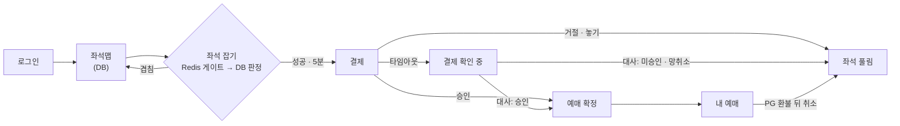
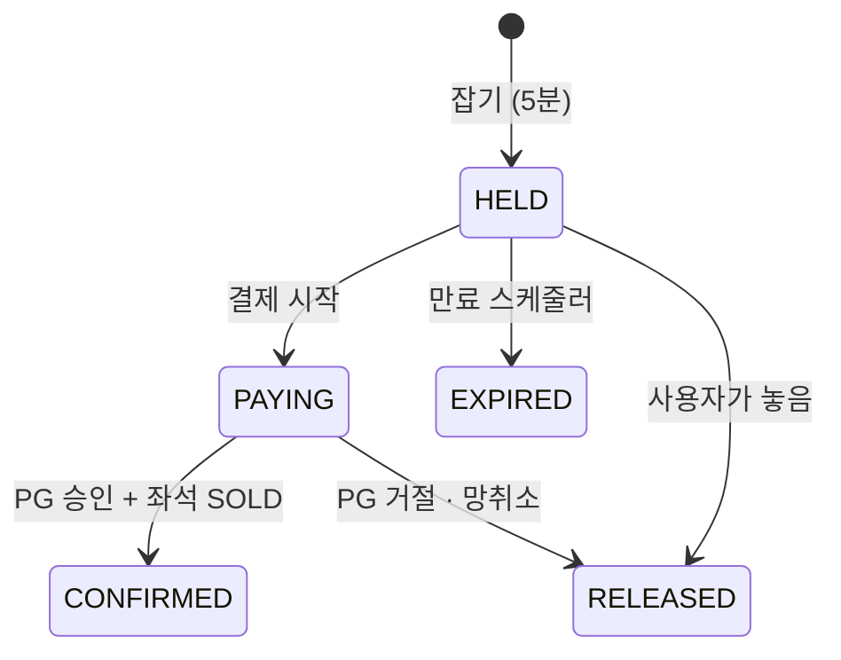

# 지정석 티켓 예매 시스템 (V7)

공연 좌석을 **좌석 단위로** 잡고, 결제하고, 확정·취소까지 끝까지 처리하는 Spring Boot 예매 시스템입니다.
주니어 개발자가 실무에서 자주 부딪히는 동시성 제어, 트랜잭션 경계, 외부 결제 연동, 상태 머신을 작은 규모로 직접 다뤄 보는 학습용 프로젝트입니다.
Redis는 이미 잡힌 좌석을 빠르게 거절하는 게이트로만 쓰고, 좌석 배정의 최종 판정은 MySQL 조건부 UPDATE가 합니다.

> - 대기열, 좌석맵 캐시, 다중 서버 대비, 운영 현황 화면, Outbox, 부하 테스트까지 들어 있던 전체판은 [`archive/v7-full`](https://github.com/AnTaeho/ticketing-system/tree/archive/v7-full) 브랜치에 있습니다.
> - 이전 버전(V1~V6: 재고 숫자 하나를 락으로 지키는 6가지 전략 비교)은 [`archive/v1-v6`](https://github.com/AnTaeho/ticketing-system/tree/archive/v1-v6) 브랜치에 있습니다. 아래 [이전 버전](#이전-버전-v1v6)에 요약을 남겼습니다.

**기술 스택**: Java 17 · Spring Boot 4.0.6 · Spring Data JPA(Hibernate 7.2) · MySQL 8.0+(로컬 9.3) · Redis 7.x(Lettuce, Lua) · Thymeleaf + 순수 JS · Gradle

---

## 왜 다시 만들었나

V6까지는 "재고 숫자 하나(`Concert.stock`, `stock:concert:{id}`)를 안전하게 줄이는" 같은 문제의 변주였습니다. 실제 공연 예매는 다릅니다.

1. **좌석마다 식별자와 가격이 다릅니다.** A구역 3열 9번은 다른 자리와 바꿀 수 없어서 카운터 하나로 표현할 수 없습니다.
2. **잡기 → 결제 → 확정의 단계가 있습니다.** "잡았지만 아직 안 산" 상태와 그 상태의 만료가 필요합니다.
3. **V6은 Redis가 진실의 원천이었습니다.** Redis 값이 과거로 돌아가면 오버셀이 나고, Kafka 전송 타임아웃을 실패로 보고 재고를 복구하면 이중 판매가 날 수 있었습니다.

V7은 **좌석 단위 판정 + DB 최종 판정 + 잡기·결제·확정 상태 머신**으로 바꿨습니다.

## 핵심 원칙

| 원칙 | 의미 |
|---|---|
| 진실은 DB | 좌석 배정은 MySQL 조건부 UPDATE의 영향 행 수로 판정합니다. Redis는 DB에서 다시 만들 수 있는 사본입니다 |
| Redis는 게이트 | 이미 잡힌 좌석 요청을 DB 앞에서 거절합니다. Redis가 틀리거나 사라지면 DB가 대신 거절하므로 중복 배정은 생기지 않습니다 |
| 락은 순간, 상태는 기간 | 판정 순간은 조건부 UPDATE와 행 락이 지키고, 결제 중인 좌석은 결제 결론이 날 때까지 풀리지 않습니다. 분산 락은 쓰지 않습니다 |
| 외부 호출은 트랜잭션 밖 | PG 호출과 Redis 반영은 DB 트랜잭션 밖에서 합니다 |
| 타임아웃은 "모름" | PG 타임아웃을 실패로 보지 않습니다. 조회로 결론을 내고, 끝내 모르면 망취소 후 좌석을 풉니다 |
| 애매하면 언더셀 | 결과를 모를 때는 좌석을 묶어 두는 쪽으로 실패합니다 |

---

## 구조



| 구성 요소 | 하는 일 | 저장소 |
|---|---|---|
| 좌석맵 | 요청마다 DB 한 쿼리로 회차 좌석 상태를 만듭니다 | MySQL |
| 좌석 게이트 | `seat:{p:N}:<seatId> = holdToken`. Lua로 한꺼번에 쓰고, 해제는 토큰이 같을 때만 지웁니다 | Redis Lua |
| 좌석 판정 | `UPDATE seat SET HELD ... WHERE seat_id IN (...) AND status = AVAILABLE`, 영향 행 수 = 좌석 수일 때만 성공 | MySQL |
| 결제 | 멱등키 · hold 행 락 · 유니크 · PG 주문번호의 네 겹으로 이중 결제를 막습니다 | MySQL + Fake PG(HTTP) |
| 스케줄러 | 선점 만료(SKIP LOCKED), 결제 대사(PG 조회·망취소) | MySQL |

### 좌석과 잡기 상태



- **결제 중(PAYING)은 만료 대상이 아닙니다.** 좌석은 결제 결론이 날 때까지 묶여 있어서, 잡기 5분이 지나도 결제 중인 좌석을 남이 가져가지 못합니다.
- **PG 타임아웃은 `UNKNOWN`입니다.** 대사 스케줄러가 PG에 조회해 승인이면 확정하고, PG에 주문이 없고 30초가 지났으면 망취소합니다. Fake PG는 망취소 기록(묘비)이 있는 주문의 늦은 승인을 거절합니다.
- **예매 취소는 PG 환불을 먼저 하고 DB를 바꿉니다.** 환불이 실패하거나 결과를 모르면 503이고 예매·좌석·결제는 그대로입니다. 같은 주문 취소는 PG가 같은 답을 주므로 다시 누르면 끝납니다. 환불만 끝나고 DB 반영이 실패했다면, 공연이 시작된 뒤라도 다시 눌러 마저 취소할 수 있습니다.

### 설계에서 고른 것

- **MySQL REPEATABLE READ 함정**: "유니크 위반 → 재조회"는 첫 SELECT 시점 스냅샷 때문에 방금 커밋된 행을 못 봅니다. 상태를 바꾸는 트랜잭션은 `READ_COMMITTED`로 두고 부모 행을 `@Lock(PESSIMISTIC_WRITE)`(`FOR UPDATE`)로 잡아 직렬화했습니다.
- **JPA로 상태 전이**: 같은 트랜잭션에서 `@Lock`으로 잠근 행은 가드가 있는 엔티티 메서드로 바꾸고, 잠그지 않고 경합하는 전이(좌석 잡기 등)는 JPQL 조건부 UPDATE의 영향 행 수로 판정합니다. 손으로 쓴 SQL은 좌석 대량 생성 하나만 남겼습니다.
- **SKIP LOCKED는 같은 트랜잭션에서**: 만료 스케줄러는 잠긴 선점(결제를 시작하는 중인 행)을 기다리지 않고 건너뜁니다. 조회와 상태 변경을 한 트랜잭션에 묶어야 그 잠금이 의미가 있습니다.
- **시간은 DB 시계**: 만료·마감 판정은 DB 시각(JPQL `current_timestamp`)으로 합니다.
- **OSIV는 끔**: 켜 두면 결제 요청이 PG 응답을 기다리는 동안 DB 커넥션을 쥐고 있어 풀이 바닥납니다. 전체판의 부하 테스트에서 실제로 겪은 문제입니다.
- **Redis 장애**: 명령 타임아웃(300ms) 뒤 게이트를 건너뛰고 DB가 판정합니다. 좌석 정합성은 그대로입니다.

---

## 실행

**필요한 것**: Java 17+, MySQL 8.0+(`SKIP LOCKED` 사용), Redis 7.x

```bash
cp src/main/resources/application-local.yml.example src/main/resources/application-local.yml
# application-local.yml의 DB 비밀번호를 고친다

./gradlew bootRun        # local 프로필, 시드 공연 1개·회차 2개(각 800석)가 자동으로 생긴다
```

- 예매 화면: http://localhost:8080/booking
- 결제 화면에서 로컬 전용 「결제 상황」(정상 승인 / 거절 / 응답 지연)을 골라 PG 타임아웃 흐름을 볼 수 있습니다.

```bash
./gradlew test           # 통합 테스트 207건. MySQL·Redis 필요
```

테스트는 전용 DB `ticketing_booking_test`(자동 생성)와 Redis DB 1을 써서 시연 데이터와 섞이지 않습니다. 같은 좌석 500명 동시 잡기, 엇갈린 순서의 다석 잡기, 게이트를 끈 DB 판정, 같은 멱등키 동시 결제, 만료 스케줄러 동시 실행 같은 동시성 테스트가 들어 있습니다.

prod 프로필은 `ddl-auto: validate`라서 [`docs/booking-schema.sql`](docs/booking-schema.sql)로 테이블을 먼저 만들어야 합니다.

---

## 프로젝트 구조

기능별 패키지 안을 역할별 하위 패키지로 나눴습니다. 규칙은 [`docs/CONVENTIONS.md`](docs/CONVENTIONS.md)에 있습니다.

```
src/main/java/com/example/ticketing/
├── user/          닉네임 데모 로그인
├── show/          공연·회차, 관리 API, 로컬 시드
├── seat/          좌석, 좌석 배치 규칙, 좌석 정보 캐시, 좌석맵
├── hold/          좌석 잡기·놓기·만료, Redis 게이트
├── payment/       결제 흐름·대사·환불, client/ (PG HTTP 클라이언트)
├── booking/       예매 발급·조회·취소
├── fakepg/        지연·거절·망취소를 재현하는 가짜 결제사
├── web/           화면 컨트롤러
└── common/        error · web · redis · jdbc · time · text · config

각 기능 안:  controller/  dto/  service/  repository/  domain/

src/main/resources/
├── scripts/booking/      Lua (hold · delete_if_equals)
├── templates/booking/    화면 템플릿
└── static/booking/       화면 CSS·JS (api.js·bk-ui.js 공용 부품 + 화면별 파일)

docs/                     CONVENTIONS.md (코드 규약), booking-schema.sql (prod 스키마)
```

---

## 이전 버전 (V1~V6)

[`archive/v1-v6`](https://github.com/AnTaeho/ticketing-system/tree/archive/v1-v6) 브랜치에 코드와 문서가 그대로 있습니다. "재고 숫자 하나를 동시에 줄일 때 무엇으로 지키나"를 6가지 방식으로 비교했습니다.

| 버전 | 방식 | 시나리오 A P99 (재고 100 · 500명) | 오버부킹 |
|---|---|---|---|
| V1 | 락 없음 (기준선) | 252 ms | 400 |
| V2 | DB 비관적 락 | 293 ms | 0 |
| V3 | DB 낙관적 락 + 재시도 | 286 ms | 0 |
| V4 | Redis 스핀 락 (Lettuce) | 3,587 ms | 0 |
| V5 | Redis Pub-Sub 락 (Redisson) | 508 ms | 0 |
| V6 | Redis 선점 + Outbox + Kafka | 402 ms | 0 |

### V6 대비 V7에서 바뀐 것

| 항목 | V6 | V7 |
|---|---|---|
| 재고 표현 | `DECR stock:concert:{id}` 카운터 | 좌석 행 + 좌석별 게이트 키 |
| 진실의 원천 | Redis (Consumer 재검증 없음) | MySQL 조건부 UPDATE |
| 사용자 응답 | 즉시 PENDING → 폴링 | 잡기는 동기 확정, 결제 승인 시 확정, 결과 모름은 대사 |
| Kafka | 예약 저장 경로 | 쓰지 않음. 취소 환불은 동기 |
| 보상 | 롤백·발행 실패 시 `INCR` (타임아웃에도) | 커밋 뒤 토큰 비교 해제. 타임아웃은 조회로 확정, 모르면 망취소 |
| 이중 결제 | 해당 없음 | 멱등키 · 행 락 + 조건부 전이 · 유니크 · PG 주문번호와 묘비 |
| Redis 장애 | 예약 불가 | 타임아웃 뒤 DB 판정 |
